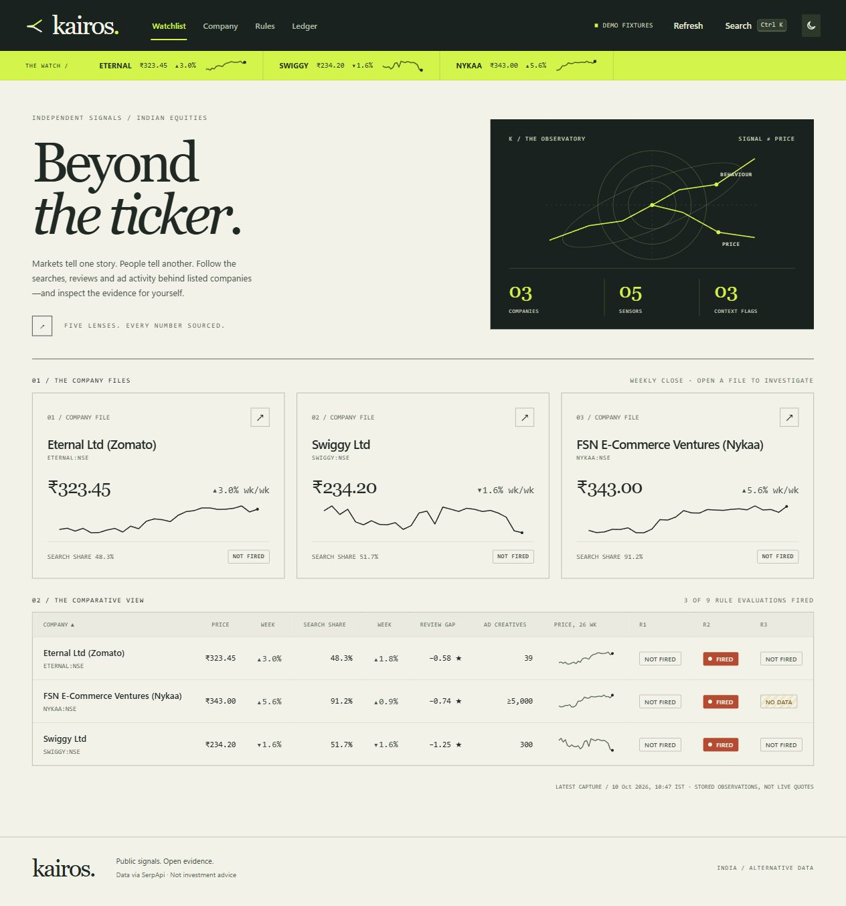
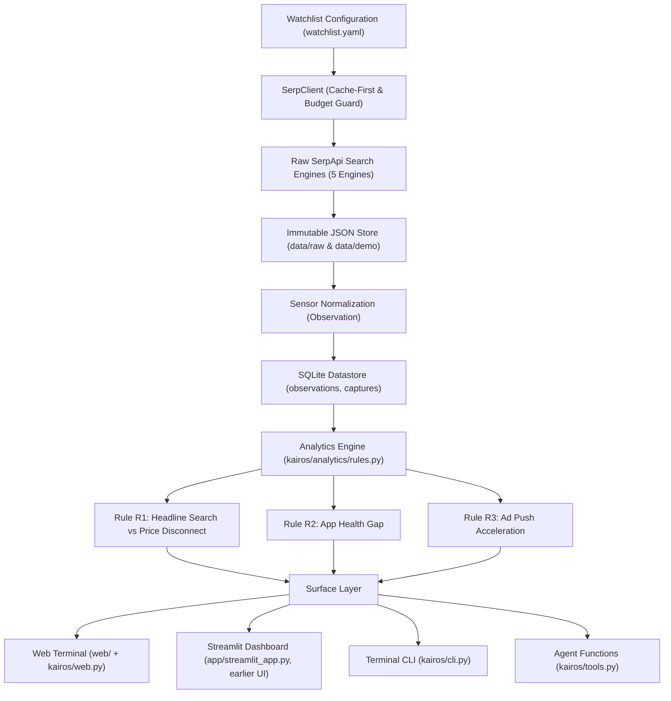

# Kairos: Alternative Data for Indian Equities, Built on SerpApi

> **One-liner:** An open-source alternative-data terminal for Indian equities, built entirely on SerpApi: every search engine becomes a sensor, every capture becomes an auditable observation, repeated captures form a time series, and every divergence alert links directly to the raw SERP response that triggered it.

---



## 1. Why Search Data is Alternative Data

Small research teams and analysts can compare public search, app-review, ad-activity and news signals with stock prices, but the signals sit on separate surfaces.

Kairos stores SerpApi responses and normalizes them into observations. Repeated CLI captures can build a dataset; an automatic scheduler is not implemented.

---

## 2. Quickstart (Offline Runtime After Installing Dependencies)

Kairos includes committed fixtures and an offline SQLite database so judges can run the entire terminal immediately without needing an API key.

```bash
# 1. Clone the repository
git clone https://github.com/catherinearulanand/Kairos.git
cd Kairos

# 2. Install dependencies in editable mode
pip install -e '.[dev]'

# 3. Launch the web terminal (offline mode, no keys)
KAIROS_OFFLINE=1 python -m kairos.web --open      # or: kairos web --open
```

### The terminal at a glance

The web terminal (`web/`, served by `kairos/web.py`) is a read-only frontend with no JavaScript
dependencies and no external requests, so it works offline. It binds to `127.0.0.1` only.

| View | What it shows |
|---|---|
| **Watchlist** | A summary header, one "company file" card per tracked company (latest price, weekly move, search share, R1 status) and a sortable comparison table of price, search share, review gap, ad creatives and every rule's status. |
| **Company** | Weekly price against search share on dual axes (12, 26 or 52 weeks) with R1's baseline and recent windows shaded and a live crosshair readout. Beside it, the **divergence map**: every week of the capture plotted against R1's firing zones, with a one-tick-per-week base-rate strip. Below: a sensor table with each engine's latest reading, the company's rule evaluations and recent headlines. |
| **Rules** | Every rule for every company, fired or not, filterable by status, rule and company. Each row expands to its conditions, windows, base rate and evidence. A rule without enough data says why. |
| **Ledger** | SerpApi calls, estimated credits and reused requests per engine and key label. |
| **Evidence inspector** | Opens from any chart point, sensor row or evidence link. Shows the engine, request parameters, capture time and file, then re-hashes the stored response in your browser and compares it with the recorded SHA-256 before showing the JSON fields Kairos reads. |

Also included: a `Ctrl K` command palette, a light/dark theme toggle (follows the OS by default),
charts you can read with the arrow keys, and `prefers-reduced-motion` support. The earlier
Streamlit dashboard still works:

```bash
KAIROS_OFFLINE=1 streamlit run app/streamlit_app.py
```

PowerShell: set `$env:KAIROS_OFFLINE = "1"`, then run `python -m kairos.web --open` (or `python -m streamlit run app/streamlit_app.py` for the Streamlit dashboard).
If Windows Application Control blocks generated CLI launchers, use `python -m kairos.cli`
in place of `kairos` (for example, `python -m kairos.cli alerts --entity NYKAA`).
The original capture interface also supports `python -m kairos.capture`.
The terminal reads stored observations and makes no SerpApi calls. Use **Refresh** after a
capture or threshold edit; every refresh reads the store again. The data-source badge in the top
bar ("Demo fixtures" or "Stored live captures") reflects the selected database, including automatic
demo fallback when no live database exists; hover it for the latest capture time.

### Running in Live Mode with SerpApi

To run live captures against SerpApi:
```bash
# Add your SerpApi API key to .env
echo "SERPAPI_API_KEY=your_actual_key_here" >> .env

# Run a dry-run first to verify credit cost
kairos snapshot --entity NYKAA --dry-run

# Execute live snapshot
kairos snapshot --entity NYKAA --mode live

# Inspect newly evaluated alerts
kairos alerts --entity NYKAA
```

Unset `KAIROS_OFFLINE` or set it to `0` in the shell before live collection; shell variables
take precedence over `.env`. The earlier `kairos-capture` command remains available.
On Windows, the installed `truststore` dependency uses native certificate-chain validation
for SerpApi requests. HTTPS certificates and hostnames are still verified.

---

## 3. How Kairos Uses SerpApi

Every observation is parsed from a stored SerpApi response. The server verifies stored JSON
bytes before serving them, and the evidence inspector re-hashes them again in your browser. Sanitized demo files use `fixture_sha256`; `raw_sha256`
preserves original response provenance and can differ. Live files use the raw hash. These
hashes check local bytes, not the authenticity of the external provider.

| Sensor ID | SerpApi Engine | Key Parameters | Metrics Extracted | What It Tells an Analyst |
|---|---|---|---|---|
| **S1** | `google_trends` | `q=Zomato,Swiggy`, `date=today 12-m`, `geo=IN`, `tz=-330` | `search_share:share` (weekly interest share vs competitor basket) | Consumer organic mindshare and competitive momentum. Backfills 52 weeks from day one. |
| **S11** | `google_finance` | `q=ETERNAL:NSE`, `window=1Y` | `price:close` (weekly closing price) | Ground-truth benchmark equity price against which public signals are compared. |
| **S4** | `google_play_product` | `product_id`, `all_reviews=true`, `sort_by=2`, `num=199` | `recent_mean`, `displayed_rating` | Real-time customer experience gap: compares newest review sample with the app store's overall rating. |
| **S8** | `google_ads_transparency_center` | `text=<domain>`, `region=2356`, `start_date`, `end_date` (14-day windows) | `active_creatives` | Advertising & customer acquisition push: compares active creatives across two 14-day windows. |
| **S9** | `google_news` | `q=<company>`, `gl=in`, `hl=en` | `article` count | Event stream and headline velocity to contextualize sudden signal shifts. |

These five engines have committed fixtures. Identifiers are hand-verified in `watchlist.yaml`;
an automated identifier-resolution pipeline is not implemented.

---

## 4. System Architecture



---

## 5. Divergence Rules

Rules live in `rules.yaml` and run deterministically. The engine never lets an LLM guess or modify a number.

| Rule ID | Role | Name | Condition | Severity / Interpretation |
|---|---|---|---|---|
| **R1** | Headline | Search Share vs Price Disconnect | 4-week mean search share vs prior 8 weeks moves `> 15%` one way, while the 4-week price return moves `> 8%` the other way. | Public search share and equity price move in opposite directions. |
| **R2** | Context | App Review Sample Gap | Recent review mean is `< displayed rating - 0.3` stars; at least 50 valid reviews. Actual sample date range and `n` are shown. | A gap at one moment; it does not establish deterioration over time. |
| **R3** | Context | Ad Activity | Latest 14-day creatives are `≥ 2.0x` the prior window, with at least five prior creatives, adjacent windows and no cap. | Activity proxy, not measured acquisition spending. |

Only R1 calculates a historical base rate over evaluable backfilled weeks. The demo has
**0/41** R1 fires for every company. This is descriptive frequency, not a prediction or
confidence score. The price safeguard rejects daily moves over 20% by default; it does
not identify or exclude all corporate actions, and the prices are unadjusted.

### What the committed demo shows (captured 10 Oct 2026)

| Company | R1 search share vs price | R2 reviews vs displayed rating | R3 ad activity |
|---|---|---|---|
| Eternal (Zomato) | Not fired: share -1.9%, price -2.7% | **Fired**: newest 199 reviews average 4.02, 0.58 below the displayed 4.6 | Not fired: 39 vs 30 creatives (1.30x) |
| Swiggy | Not fired: share +1.8%, price -13.8% | **Fired**: 3.25, 1.25 below the displayed 4.5 | Not fired: 300 vs 200 creatives (1.50x) |
| Nykaa | Not fired: share -1.0%, price -2.3% | **Fired**: 3.76, 0.74 below the displayed 4.5 | Insufficient data: a window hit the API's count limit |

R1 does not fire for any company, and the thresholds were not adjusted to make it. The review
gap (R2) is a gap at one moment in a sample of the newest reviews, not a trend.

---

## 6. Credit Budget & Caching

Kairos is architected specifically around SerpApi's quota model:

1. **Cache-First Client:** Local cache mode reuses stored identical requests without an expiry. Live mode makes a fresh request, deduplicating identical requests within one run. Provider cache classification and ledger credits are estimates; the Account API is the quota authority.
2. **Shared Request Deduplication:** Competitors sharing a Trends basket (e.g., `Eternal` and `Swiggy` both requesting `Zomato,Swiggy`) execute the query once; the second entity consumes the cached response at 0 credits.
3. **Credit Budget Guard:** The reserve (`--reserve 30`) is enforced before collection. If account quota is unavailable, collection stops. Use `--reserve 0` explicitly to proceed without the quota guard.
4. **Dry-Run Mode:** `kairos snapshot --dry-run` calculates the upper-bound credit cost before making network requests.

Run `kairos credits` to inspect the credit ledger:
```text
key            engine                              paid  credits  free
dev            google_ads_transparency_center         6        6     0
dev            google_finance                         3        3     0
dev            google_news                            3        3     0
dev            google_play_product                    6        6     0
dev            google_trends                          2        2     1
total                                                20       20     1
```
*(Notice `free: 1` on `google_trends` — the shared query between Eternal and Swiggy was served at zero cost.)*

---

## 7. Command Line Interface (CLI)

The `kairos` CLI mirrors all functionality available in the dashboard:

```bash
# 1. Check current credit ledger and quota
kairos credits

# 2. Plan snapshot without spending credits
kairos snapshot --entity NYKAA --dry-run

# 3. View current rule evaluations (all statuses)
kairos alerts --entity NYKAA

# 4. Deep-dive into an alert's conditions and underlying SerpApi captures
kairos explain NYKAA:R2:2026-10-10

# 5. Serve the web terminal (read-only; --open launches a browser)
kairos web --open
```

---

## 8. Agent Functions (`kairos/tools.py`)

Kairos exposes its signal and alert store as clean, typed Python functions for AI agent frameworks (LangChain, OpenAI Agents SDK, Claude Agent SDK):

```python
from kairos import tools

# 1. Fetch tracked entities
entities = tools.list_entities()

# 2. Query 12-week normalized signal timeseries
signals = tools.get_signals("NYKAA", sensor="search_share", weeks=12)

# 3. Retrieve every rule evaluation with evidence IDs
alerts = tools.get_alerts("NYKAA")
for alert in alerts:
    print(f"[{alert['status'].upper()}] {alert['sentence']}")

# 4. Audit the current review-gap evaluation and its SerpApi captures
review_alert = next(a for a in alerts if a["rule_id"] == "R2")
explanation = tools.explain_alert(review_alert["alert_id"])
print("Captures used:", [c["engine"] for c in explanation["captures"]])
```

---

## 9. Extending Kairos: Add a Sensor

Kairos uses a modular plugin architecture. Read [CONTRIBUTING.md](CONTRIBUTING.md) for a worked example showing how to create a new `Sensor` subclass and test it against recorded fixtures.

---

## 10. Limitations & Honesty Guardrails

- **Signals, Not Predictions:** Kairos does not predict stock prices or make trade recommendations. It detects and explains divergences between public behavior and price.
- **Samples, Not Totals:** Review means describe the newest returned reviews. News counts describe at most 60 sampled headlines in explicitly dated completed weeks. Ads totals at the provider cap are lower bounds; exact capped ratios are suppressed.
- **Strict LLM Boundary:** Quantitative sentences come from deterministic templates. Optional model JSON is checked with regular expressions for digits/number words, a word limit and evidence-ID membership. These checks do not establish the truth of the model's prose. Offline mode disables model generation.
- **Freshness:** Capture timestamps are separate from observation weeks. Collection attempts are recorded; a failed or unfinished latest attempt marks dependent rules insufficient and displays a dashboard warning. Older successful readings remain available with their dates. Demo-backed replay databases retain the demo source label.
- **Capture integrity:** Trends share requires the whole configured competitor basket. All parser and evidence reads verify byte hashes and repository path containment. Demo export stages complete successful bundles, checks metric equality after sanitization and preserves collection outcomes before publication. Already sanitized fixtures keep their original bytes. Legacy databases are backfilled from committed captures; historical attempt boundaries cannot be reconstructed exactly.
- **Integration:** Ads series share sensor/metric but differ by `dims.window`. Analytics opens source databases read-only; commentary uses the separate writable `data/alerts.db` cache and invalidates when analytical inputs change.
- **Web terminal safeguards:** The server is read-only, binds to loopback, rejects foreign `Host` headers and sends a strict content-security policy. Captures are served only if listed in the database and only after their bytes match the recorded hash. The frontend renders every value from the data (including news headlines) as text, never as HTML, and the tests fail if `innerHTML` is introduced.
- **Verification:** Automated checks run the offline test suite, rendered dashboard and CLI, plus a full-history secret scan. See [app readiness](docs/APP_READINESS.md) for the verified revision, reviewed scanner matches and live-provider status. The screenshot above was captured from the running offline app. Video and submission remain the team's responsibility.

---

## 11. AI Tools Disclosure

The team's disclosure names Claude and Gemini. Codex also performed code review, integration fixes and regression-test work. Human owners remain responsible for identifier verification, interpretation and submission.

---

## 12. Disclaimer & License

**Disclaimer:** Data via SerpApi. Kairos is an analytical research tool and does not provide investment advice.

Licensed under [MIT](LICENSE).
