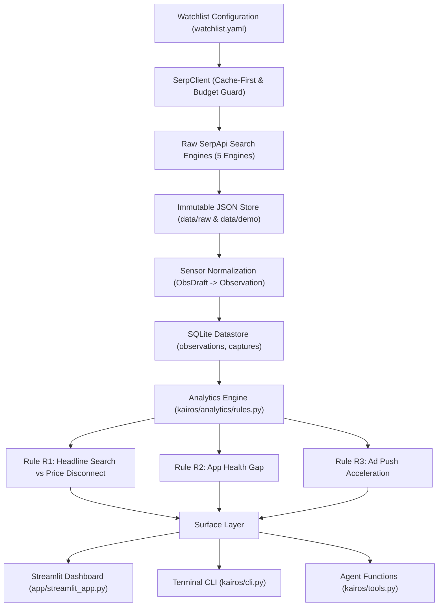

# Kairos: Alternative Data for Indian Equities, Built on SerpApi

> **One-liner:** An open-source alternative-data terminal for Indian equities, built entirely on SerpApi: every search engine becomes a sensor, every capture becomes an auditable observation, repeated captures form a time series, and every divergence alert links directly to the raw SERP response that triggered it.

---

## 1. Why Search Data is Alternative Data

Hedge funds and institutional quants routinely pay six figures for alternative data: customer sentiment, consumer app ratings, ad spend velocity, and organic search volume. Retail investors and small research teams in India have never had access to this intelligence.

The raw signals already exist in public search surfaces, but they remain scattered and unrecorded over time. Kairos is the layer that transforms SerpApi's search engines into a scheduled network of time-series sensors. A single SERP query is merely a snapshot; the same query repeated over time, normalized into a strict schema, is a continuous dataset.

---

## 2. Quickstart (Works 100% Offline with Zero Setup)

Kairos includes committed fixtures and an offline SQLite database so judges can run the entire terminal immediately without needing an API key.

```bash
# 1. Clone the repository
git clone https://github.com/catherinearulanand/Kairos.git
cd Kairos

# 2. Install dependencies in editable mode
pip install -e .

# 3. Launch the Streamlit Terminal (Offline Mode)
KAIROS_OFFLINE=1 streamlit run app/streamlit_app.py
```

### Running in Live Mode with SerpApi

To run live captures against SerpApi:
```bash
# Add your SerpApi API key to .env
echo "SERPAPI_API_KEY=your_actual_key_here" >> .env

# Run a dry-run first to verify credit cost
kairos snapshot --entity NYKAA --dry-run

# Execute live snapshot
kairos snapshot --entity NYKAA --mode live

# Inspect newly evaluated alerts
kairos alerts --entity NYKAA
```

---

## 3. How Kairos Uses SerpApi

SerpApi is the load-bearing data provider in Kairos. Every observation is parsed from a SerpApi response, and every number traces back to a SHA-256-verified capture.

| Sensor ID | SerpApi Engine | Key Parameters | Metrics Extracted | What It Tells an Analyst |
|---|---|---|---|---|
| **S1** | `google_trends` | `q=Zomato,Swiggy`, `date=today 12-m`, `geo=IN`, `tz=-330` | `search_share:share` (weekly interest share vs competitor basket) | Consumer organic mindshare and competitive momentum. Backfills 52 weeks from day one. |
| **S11** | `google_finance` | `q=ETERNAL:NSE`, `window=1Y` | `price:close` (weekly closing price) | Ground-truth benchmark equity price against which public signals are compared. |
| **S4** | `google_play_product` | `product_id`, `all_reviews=true`, `sort_by=2`, `num=199` | `recent_mean`, `displayed_rating` | Real-time customer experience gap: compares newest review sample with the app store's overall rating. |
| **S8** | `google_ads_transparency_center` | `text=<domain>`, `region=2356`, `start_date`, `end_date` (14-day windows) | `active_creatives` | Advertising & customer acquisition push: compares active creatives across two 14-day windows. |
| **S9** | `google_news` | `q=<company>`, `gl=in`, `hl=en` | `article` count | Event stream and headline velocity to contextualize sudden signal shifts. |

*Additional engines used for entity resolution include `google_trends_autocomplete`, `google_play`, and `google_finance` suggestions.*

---

## 4. System Architecture



---

## 5. Divergence Rules

Rules live in `rules.yaml` and run deterministically. The engine never lets an LLM guess or modify a number.

| Rule ID | Role | Name | Condition | Severity / Interpretation |
|---|---|---|---|---|
| **R1** | Headline | Search Share vs Price Disconnect | 4-week mean search share vs prior 8 weeks moves `> 15%` one way, while the 4-week price return moves `> 8%` the other way. Windows with corporate actions excluded. | **High**: Public consumer interest and equity market pricing point in opposite directions. |
| **R2** | Context | App Review Sample Gap | Mean of newest 199 Play Store reviews is `< displayed rating - 0.3` stars. Sample date range and `n` explicitly stated. | **Medium**: Recent user sentiment has deteriorated below the advertised store rating. |
| **R3** | Context | Ad Acceleration Push | Active ad creatives in the latest 14 days are `≥ 2.0x` the prior 14 days. | **Medium**: Company is heavily scaling acquisition spend. |

Every alert calculates its **Historical Base Rate** (e.g., "True in 0 of 41 weeks") over the entire 52-week backfill, telling analysts immediately whether an alert is a rare inflection or normal volatility.

---

## 6. Credit Budget & Caching

Kairos is architected specifically around SerpApi's quota model:

1. **Cache-First Client:** Identical searches within 1 hour are returned by SerpApi's caching tier at 0 credits.
2. **Shared Request Deduplication:** Competitors sharing a Trends basket (e.g., `Eternal` and `Swiggy` both requesting `Zomato,Swiggy`) execute the query once; the second entity consumes the cached response at 0 credits.
3. **Credit Budget Guard:** An automated reserve (`--reserve 30`) prevents accidental exhaustion during captures.
4. **Dry-Run Mode:** `kairos snapshot --dry-run` calculates the upper-bound credit cost before making network requests.

Run `kairos credits` to inspect the credit ledger:
```text
key            engine                              paid  credits  free
dev            google_ads_transparency_center         6        6     0
dev            google_finance                         3        3     0
dev            google_news                            3        3     0
dev            google_play_product                    6        6     0
dev            google_trends                          2        2     1
total                                                20       20     1
```
*(Notice `free: 1` on `google_trends` — the shared query between Eternal and Swiggy was served at zero cost.)*

---

## 7. Command Line Interface (CLI)

The `kairos` CLI mirrors all functionality available in the dashboard:

```bash
# 1. Check current credit ledger and quota
kairos credits

# 2. Plan snapshot without spending credits
kairos snapshot --entity NYKAA --dry-run

# 3. View active and historical divergence alerts
kairos alerts --entity NYKAA

# 4. Deep-dive into an alert's conditions and underlying SerpApi captures
kairos explain NYKAA:R2:2026-10-10
```

---

## 8. Agent Functions (`kairos/tools.py`)

Kairos exposes its signal and alert store as clean, typed Python functions for AI agent frameworks (LangChain, OpenAI Agents SDK, Claude Agent SDK):

```python
from kairos import tools

# 1. Fetch tracked entities
entities = tools.list_entities()

# 2. Query 12-week normalized signal timeseries
signals = tools.get_signals("NYKAA", sensor="search_share", weeks=12)

# 3. Retrieve fired alerts with evidence IDs
alerts = tools.get_alerts("NYKAA")
for alert in alerts:
    print(f"[{alert['status'].upper()}] {alert['sentence']}")

# 4. Audit an alert down to its raw SerpApi captures
explanation = tools.explain_alert("NYKAA:R2:2026-10-10")
print("Captures used:", [c["engine"] for c in explanation["captures"]])
```

---

## 9. Extending Kairos: Add a Sensor

Kairos uses a modular plugin architecture. Read [CONTRIBUTING.md](CONTRIBUTING.md) for a worked example showing how to create a new `Sensor` subclass and test it against recorded fixtures.

---

## 10. Limitations & Honesty Guardrails

- **Signals, Not Predictions:** Kairos does not predict stock prices or make trade recommendations. It detects and explains divergences between public behavior and price.
- **Samples, Not Totals:** Play Store review samples and sampled store locations are statistical samples, not census totals. The UI explicitly states sample size ($n$) and time intervals.
- **Strict LLM Boundary:** The LLM never computes or alters numbers. Every quantitative sentence is filled by a deterministic template. Any LLM commentary is strictly validated by an AST-based guard that rejects numerals and enforces citations.

---

## 11. AI Tools Disclosure

Built with Claude and Gemini coding assistants for specification, code generation, and test validation under team architectural direction. All rule logic, validation formulas, and schemas were designed and verified by the team.

---

## 12. Disclaimer & License

**Disclaimer:** Data via SerpApi. Kairos is an analytical research tool and does not provide investment advice.

Licensed under the **MIT License**.
